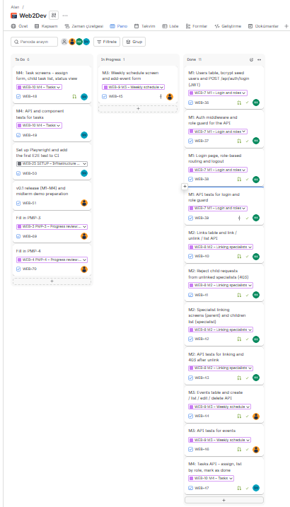

# Project Management Plan (PMP)

> The purpose of this PMP is to practice planning and tracking work in Jira. Keep it short: most of the content is a summary of what you set up in Jira.
> Keep this file at `docs/PMP.md`. Each section is one Jira epic (PMP-1 … PMP-6); mark the epic Done when the section is complete.
> Save screenshots in `docs/img/`.

| Section | Content | Required by |
|---|---|---|
| PMP-1 | Project, Jira setup, team and roles | Week 6 |
| PMP-2 | Work packages (epics) and sprint plan | Week 6 |
| PMP-3 | Progress review: mid-term (v0.1) | Mid-term evaluation (Week 8 / 9) |
| PMP-4 | Progress review: v0.2 | Week 10 |
| PMP-5 | Progress review: final (v1.0) | Final evaluation |
| PMP-6 | Retrospective | Final evaluation |

---

## PMP-1. Project and Team

### Project and Jira Setup

**Project in one sentence:** A web-based decision support platform that brings parents, specialists and the child together around a shared schedule, task list and observation records, with role-based AI summaries.  
**Jira project key:** WEB  
**Jira board link:** https://student-team-kriaqp7j.atlassian.net/jira/software/projects/WEB/boards/4  
**GitHub repository:** https://github.com/SENG383-Web2Dev/WebProject  

### Team and Roles

| Name | Jira / GitHub username | Role |
|---|---|---|
| Hasan Yağız Koşar | Hasan Yağız Koşar / hasan-yagiz-kosar | Full-Stack Developer |
| Sude Naz Metli | Sudenaz Metli / sudenazmetli | Full-Stack Developer, Team Contact Person |
| İrem Ozan | İrem Ozan / iremozan | Full-Stack Developer |

---

## PMP-2. Plan

### Work Packages (Epics)

> One row per Jira epic. Number of tasks = how many tasks you created under that epic.

| Epic | Owner | Number of tasks | Planned sprint(s) |
|---|---|---|---|
| M1 – Login and roles | Hasan Yağız Koşar | 4 | Sprint 2 |
| M2 – Linking specialists | Hasan Yağız Koşar | 4 | Sprint 2 |
| M3 – Weekly schedule | İrem Ozan | 3 | Sprint 2 |
| M4 – Tasks | Sude Naz Metli | 3 | Sprint 2 |
| M5 – Specialist entries | İrem Ozan | 3 | Sprint 3 |
| M6 – Documents | İrem Ozan | 3 | Sprint 3 |
| M7 – Weekly statistics | Sude Naz Metli | 3 | Sprint 3 |
| M8 – Role-based AI summary | Sude Naz Metli | 5 | Sprint 1 (AI provider decision), Sprint 3 |

Other epics: SETUP (infrastructure, CI, E2E and coverage tasks, Sprints 1–4), SRS and DESIGN (first versions in Sprint 1, final versions in Sprint 3), PMP-1 … PMP-6 (one task per section, in the sprint where the section is due). Release tasks (v0.0, v0.1, v0.2, v1.0) close each sprint.

### Sprint Plan

> One row per Jira sprint. Align sprints with the weekly schedule.

| Sprint | Weeks | Sprint goal | Ends with |
|---|---|---|---|
| Sprint 1 | Weeks 5–6 (30 Oct – 8 Nov) | Jira and repo setup, walking skeleton, first versions of SRS and SDD, PMP-1 and PMP-2 | Walking skeleton (v0.0), Week 6 |
| Sprint 2 | Weeks 7–8 (9 – 22 Nov) | M1–M4 working with API tests; Playwright set up and first E2E test in CI; PMP-3 and PMP-4 | Release v0.1, mid-term |
| Sprint 3 | Weeks 9–10 (23 Nov – 6 Dec) | Mid-term demo (week 9); M5–M8 working; E2E tests for the 3 critical flows; branch coverage ≥40%; SRS/SDD final; PMP-5 | Release v0.2, Week 10 |
| Sprint 4 | Weeks 11–12 (7 – 20 Dec) | An E2E test for each of M1–M8; branch coverage ≥60%; PMP-6; final report, final peer review, presentation and live demo | Release v1.0, final |

---
## PMP-3. Progress Review: Mid-term (v0.1)

**Review date:** 14 November 2026 (end of Week 7, middle of Sprint 2)

**Jira board screenshot:**  

| Epic | Planned for this point | Status (Done / In progress / Not started) |
|---|---|---|
| M1 – Login and roles | Login with JWT, role guard, login page and role-based routing, API tests (WEB-36 – WEB-39) | Done |
| M2 – Linking specialists | Link / unlink / list API, 403 for unlinked specialists, linking screens, API tests (WEB-40 – WEB-43) | Done |
| M3 – Weekly schedule | Events API (WEB-44), weekly schedule screen (WEB-45), API tests (WEB-46) | In progress (API and tests merged; schedule screen in review) |
| M4 – Tasks | Tasks API (WEB-47), task screens (WEB-48), API and component tests (WEB-49) | In progress (API merged; screens and tests not started) |
| SETUP – E2E | Playwright set up and first E2E test in CI (WEB-50) | Not started |
| M5 – M8 | Planned for Sprint 3 (only the M8 AI provider decision was planned for Sprint 1 and is done) | Not started |

**Changes to the plan (if any):**  
- The events API (WEB-44) was written early, but it could only be merged after M1 and M2, because it uses the same login and child access checks. This moved the M3 schedule screen to the second half of Week 7, still inside Sprint 2.
- The sample `tasks` table and `GET /api/tasks` endpoint from the walking skeleton were replaced by the M4 tasks API (WEB-47), as planned in the SDD.
- WEB-45 (in review) adds the child's profile id (`childProfileId`) to the `GET /api/auth/me` response, so the weekly schedule can be shown on the child's screen. 
- No changes to sprints or epic owners. The remaining Sprint 2 work (WEB-45, WEB-48, WEB-49, WEB-50, PMP-4 (WEB-70) and the v0.1 release WEB-51) is still planned to finish by 22 November.
---

## PMP-4. Progress Review: v0.2

**Jira board screenshot:**  

| Epic | Planned for this point | Status (Done / In progress / Not started) |
|---|---|---|
| | | |
| | | |

**Changes to the plan (if any):**

---

## PMP-5. Progress Review: Final (v1.0)

**Jira board screenshot:**  

| Epic | Planned for this point | Status (Done / In progress / Not started) |
|---|---|---|
| | | |
| | | |

**Changes to the plan (if any):**

---

## PMP-6. Retrospective

- What worked well in using Jira:
- What we would do differently:
