# Software Design Document (SDD)

**Team name:** Web2Dev  
**Version:** ☒ First version (Week 6) ☐ Final (Week 10)  
**Last updated:** 2026-11-07

---

## 1. Architecture Overview

The system is a client–server web application. A React (Vite) single-page client calls a REST API built with Express; the API checks each request's JWT and the user's role, and stores data in SQLite. AI summaries are produced by one backend module that calls the Gemini API, or returns a fixed summary in mock mode.

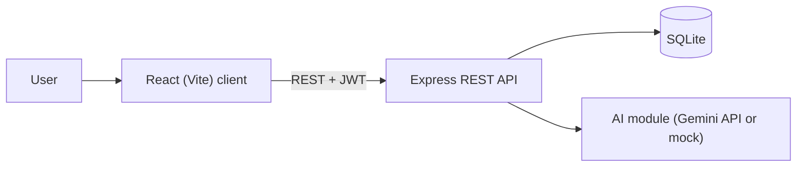

### Backend Layers

Every request passes through the same layers, so access rules are checked in one place for all modules (NFR-02).

| Layer | Folder | Responsibility |
|---|---|---|
| Routes | `server/src/routes/` | One router per module. Reads the request, calls a service and sends the JSON response. |
| Middleware | `server/src/middleware/` | `requireAuth` checks the JWT and returns 401 if it is missing or invalid (FR-M1-04). `requireRole` returns 403 if the user's role may not use the endpoint (FR-M1-05). `requireChildAccess` lets a request about a child through only for the child's parent, a specialist with an active link (FR-M2-06), or the child's own account where the endpoint allows it; otherwise it returns 403. |
| Services | `server/src/services/` | Validation and business rules, and the SQL queries (through `server/src/db.js`). |
| AI module | `server/src/services/aiService.js` | The only file that calls the Gemini API. The API key is read from the server environment variable `GEMINI_API_KEY` (NFR-03). When `AI_MOCK=true` it returns a fixed summary without calling the API (FR-M8-07); tests and CI use this mode. |

### Technology Stack

| Layer | Technology |
|---|---|
| Frontend | React (Vite) |
| Backend | Node.js, Express, JWT authentication |
| Database | SQLite |
| Testing | Vitest, Jest + Supertest, Playwright |
| CI | GitHub Actions |
| AI | Gemini API, accessed through a single backend module; mock mode for tests and CI |

---

## 2. Module Design

Paths are relative to `server/src/` and `client/src/`. The files named below are the planned structure; modules are added sprint by sprint, so some of them do not exist yet. Shared parts used by every module: `middleware/auth.js` and `middleware/childAccess.js` on the backend, `api/client.js` (a `fetch` wrapper that adds the JWT) and `auth/AuthContext.jsx` (the logged-in user and role) on the frontend.

| Module | Backend (Express) | Frontend (React) | Implements requirements |
|---|---|---|---|
| M1 Login and roles | `routes/auth.js`, `services/authService.js` (bcrypt password check, JWT signing), `middleware/auth.js` | `pages/LoginPage.jsx`, `auth/AuthContext.jsx`, `components/RoleRoute.jsx` (opens a page only for the allowed role) | FR-M1-01 to FR-M1-06, NFR-01 |
| M2 Linking specialists | `routes/children.js`, `routes/specialists.js`, `services/linkService.js`, `middleware/childAccess.js` | `pages/ParentSpecialistsPage.jsx`, `pages/SpecialistChildrenPage.jsx` | FR-M2-01 to FR-M2-06 |
| M3 Weekly schedule | `routes/events.js`, `services/eventService.js` (end time after start time, week filter) | `components/WeeklySchedule.jsx`, `components/EventForm.jsx` | FR-M3-01 to FR-M3-05 |
| M4 Tasks | `routes/tasks.js`, `services/taskService.js` (required fields, fixed list of development areas) | `components/TaskList.jsx`, `components/AssignTaskForm.jsx`, `pages/ChildHomePage.jsx` | FR-M4-01 to FR-M4-06 |
| M5 Specialist entries | `routes/observations.js`, `services/observationService.js` (author-only edit, "edited" flag) | `components/ObservationList.jsx`, `components/ObservationForm.jsx` | FR-M5-01 to FR-M5-05 |
| M6 Documents | `routes/documents.js`, `services/documentService.js`, `multer` for uploads (file type and 10 MB limit); files are saved in `server/uploads/`, which is not committed | `pages/DocumentsPage.jsx` | FR-M6-01 to FR-M6-05 |
| M7 Weekly statistics | `routes/stats.js`, `services/statsService.js` (done tasks / tasks due in the week, in total and by area) | `components/WeeklyStats.jsx` | FR-M7-01 to FR-M7-04 |
| M8 Role-based AI summary | `routes/aiSummaries.js`, `services/summaryService.js` (collects the records the user may see, builds the parent or specialist prompt), `prompts/parentPrompt.js`, `prompts/specialistPrompt.js`, `services/aiService.js` | `components/AiSummaryCard.jsx` | FR-M8-01 to FR-M8-08 |

The pages combine these components by role: `ParentDashboardPage.jsx` shows M3, M4, M5, M7 and M8 for the selected child, `SpecialistChildrenPage.jsx` shows the same child's records for a linked specialist, and `ChildHomePage.jsx` shows only the child's own tasks and schedule (FR-M1-05).

---

## 3. Data Model

The entities below come from the roles and modules in the SRS. Each child's records (events, tasks, observations, documents, AI summaries) belong to one child, and access is decided by the user's role and by an active specialist link. Users and child profiles are created by the seed script, because the SRS has no sign-up screen and only synthetic data is used (NFR-03).

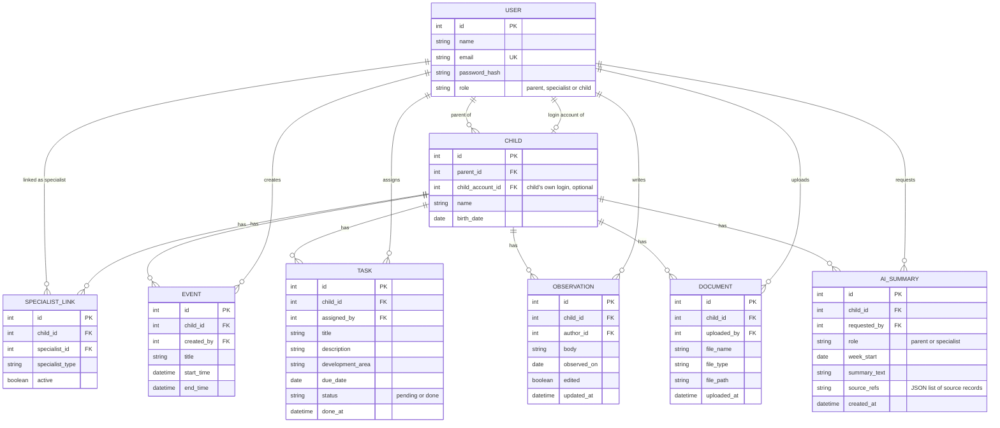

**SQLite types.** The types in the diagram are logical types. SQLite has no date, time or boolean type, so they are stored as follows: `int` as `INTEGER`, `string` as `TEXT`, `date` and `datetime` as ISO-8601 `TEXT` (for example `2026-11-09` and `2026-11-09T14:00`), and `boolean` as `INTEGER` 0 or 1 with a `CHECK` constraint. An event's start and end are full datetimes, so the rule "end time after start time" (FR-M3-04) is one comparison, and the weekly view selects events whose `start_time` falls in the week.

**AI summaries are stored.** `POST /api/children/:childId/ai-summaries` calls the AI once and saves the result. `GET` returns the saved summary without a new AI call, so opening the dashboard again costs no extra API request. There is at most one summary per child, role and week (`UNIQUE (child_id, role, week_start)`); requesting a new one replaces it. A summary is not updated automatically when records change; the user requests a new one. `source_refs` keeps the type and id of each record the summary used (for example `[{"type":"task","id":12},{"type":"observation","id":4}]`), which the client turns into links (FR-M8-05).

Note: The `tasks` table created in WEB-23 was a sample table to test the database setup. WEB-47 replaced it with the `TASK` entity above.

---

## 4. API / Interfaces

All endpoints except login and the health check require a valid JWT (FR-M1-04); the health check returns no user data. Access checks run in the backend for every request (NFR-02). Bodies are JSON, with camelCase field names in JSON and snake_case column names in the database. Errors return `{ "error": "message" }` with status 400 (invalid input), 401 (missing or invalid token), 403 (not allowed) or 404 (not found). A `week` value is the date of the Monday that starts the week, as `YYYY-MM-DD`. Endpoints are added module by module; `server/README.md` lists the ones that exist.

**Walking skeleton (v0.0).** Before login and the `TASK` entity exist, a temporary `GET /api/tasks` (WEB-30) returns the sample tasks from the WEB-23 `tasks` table without a token, and the React task list (WEB-31) shows them. This proves that SQLite, Express and React work together end to end. The temporary endpoint is removed when `GET /api/children/:childId/tasks` is implemented.

| Method | Endpoint | Description | Module |
|---|---|---|---|
| POST | `/api/auth/login` | Log in with email and password; returns a JWT and the user's role, which comes from the account (FR-M1-01 to FR-M1-04). For a child account the user also has its child profile id, the same as `GET /api/auth/me` | M1 |
| GET | `/api/auth/me` | The logged-in user's id, name, email and role; for a child account also its child profile id. The client calls it after a page refresh to restore the user and role (FR-M1-05) | M1 |
| POST | `/api/auth/logout` | Log out; the client deletes its stored token (FR-M1-06, Should) | M1 |
| GET | `/api/health` | Health check; implemented in WEB-20 | — |
| GET | `/api/children` | Child profiles of the logged-in parent, used to choose the child on the dashboard | M2 |
| GET | `/api/specialist/children` | Children with an active link to the logged-in specialist (FR-M2-05) | M2 |
| POST | `/api/children/:childId/specialists` | Link a registered specialist; body: `email`, `specialistType`. Returns 404 if the email does not belong to a registered specialist (FR-M2-01, FR-M2-02) | M2 |
| GET | `/api/children/:childId/specialists` | List the specialists linked to a child (FR-M2-03) | M2 |
| DELETE | `/api/children/:childId/specialists/:specialistId` | Unlink a specialist by setting the link inactive; the client asks for confirmation first (FR-M2-04) | M2 |
| GET | `/api/children/:childId/events?week=YYYY-MM-DD` | Events of a child for one week (FR-M3-02, FR-M3-03) | M3 |
| POST | `/api/children/:childId/events` | Add an event; body: `title`, `startTime`, `endTime`. Returns 400 if the end time is not after the start time (FR-M3-01, FR-M3-04) | M3 |
| PUT | `/api/events/:id` | Edit an event; only its creator (FR-M3-05, Should) | M3 |
| DELETE | `/api/events/:id` | Delete an event; only its creator (FR-M3-05, Should) | M3 |
| GET | `/api/children/:childId/tasks` | Tasks of a child with their status and who assigned them. The parent and linked specialists see all of the child's tasks (FR-M4-04); the child account sees only its own tasks (FR-M4-02) | M4 |
| POST | `/api/children/:childId/tasks` | Assign a task; body: `title`, `description`, `developmentArea`, `dueDate`. Returns 400 without a title or due date (FR-M4-01, FR-M4-05, FR-M4-06) | M4 |
| PATCH | `/api/tasks/:id/done` | The child marks one of their own tasks as done (FR-M4-03) | M4 |
| GET | `/api/children/:childId/observations` | List observations, newest first; not available to the child (FR-M5-02, FR-M5-05) | M5 |
| POST | `/api/children/:childId/observations` | Add an observation; body: `body`, `observedOn` (FR-M5-01) | M5 |
| PUT | `/api/observations/:id` | Edit an observation; only its author, marked as edited (FR-M5-03, FR-M5-04) | M5 |
| POST | `/api/children/:childId/documents` | Upload a PDF, JPG or PNG file up to 10 MB as `multipart/form-data`; other files return 400 (FR-M6-01, FR-M6-02) | M6 |
| GET | `/api/children/:childId/documents` | List documents with name, type, uploader and date; not available to the child (FR-M6-03, FR-M6-05) | M6 |
| GET | `/api/documents/:id` | View or download a document; not available to the child (FR-M6-04, FR-M6-05) | M6 |
| GET | `/api/children/:childId/stats?week=YYYY-MM-DD` | Task completion rate for a week, in total and by development area; the rate is `null` when no tasks are due, and the client shows "No tasks this week" (FR-M7-01 to FR-M7-04) | M7 |
| POST | `/api/children/:childId/ai-summaries` | Generate a summary of a week with the prompt for the user's role; body: `week`. Saves it and returns the text, the "AI-generated" label and the source records. Returns 503 if the AI service is unavailable (FR-M8-01 to FR-M8-08) | M8 |
| GET | `/api/children/:childId/ai-summaries?week=YYYY-MM-DD` | The saved summary of a week for the user's role, without calling the AI; 404 if none has been generated yet (FR-M8-01, FR-M8-04, FR-M8-05) | M8 |

### Access Rules

`requireChildAccess` and `requireRole` apply these rules. In the required scope, a linked specialist sees all of the child's records. Requests about a child from a specialist without an active link return 403 (FR-M2-06).

| Resource | Parent (own child) | Linked specialist | Child (own profile) |
|---|---|---|---|
| Child list | Own children | Linked children | — |
| Specialist links | Link, list, unlink | — | — |
| Events | Add, list; edit and delete own | Add, list; edit and delete own | List |
| Tasks | Assign, list all | Assign, list all | List own, mark as done |
| Observations | List | Add, list; edit own | 403 |
| Documents | Upload, list, download | Upload, list, download | 403 |
| Weekly statistics | View | View | 403 |
| AI summary | Request, view (parent prompt) | Request, view (specialist prompt) | 403 |

---

## 5. Critical Flows

The three flows are the critical flows in SRS Section 4. Each diagram shows the main path and the error case named in the SRS.

### Flow 1: A specialist assigns a task and the child completes it

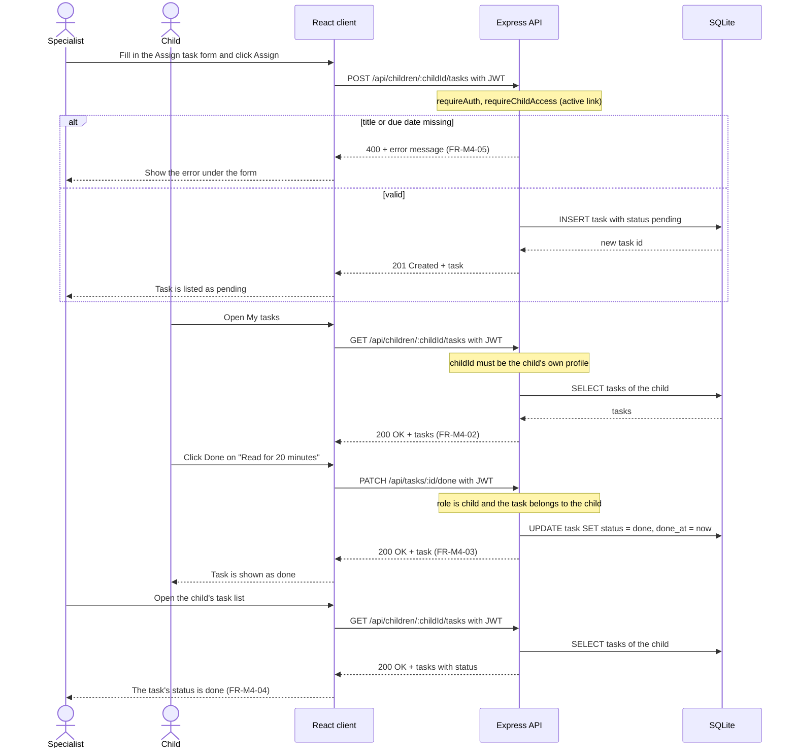

### Flow 2: The parent links and unlinks a specialist

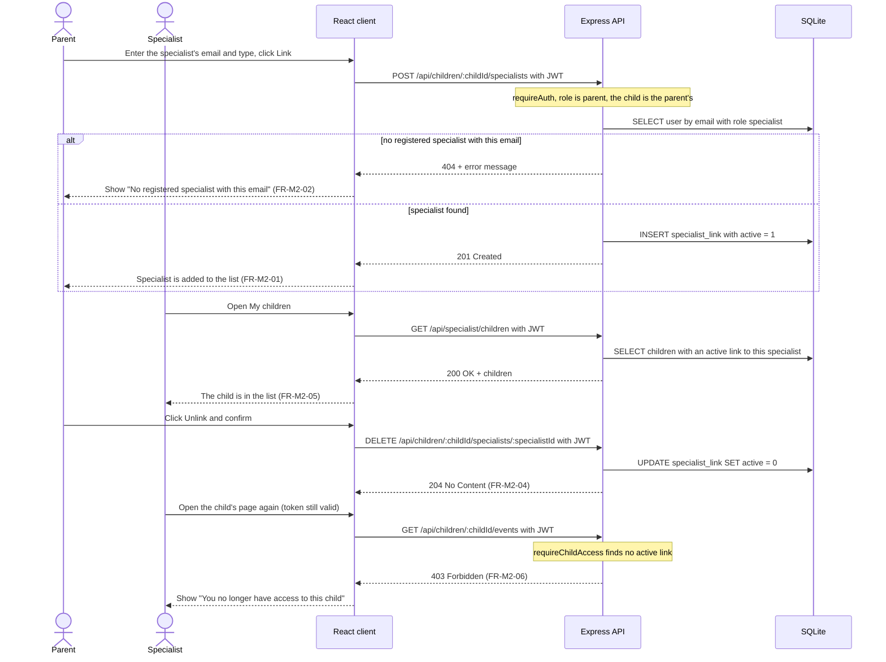

### Flow 3: The parent gets the AI summary of the week

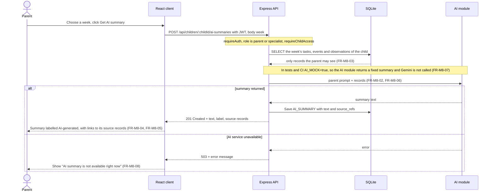

In the error case nothing is saved, and the rest of the dashboard keeps working (FR-M8-08).

---

## 6. User Interface

The wireframes below show the main screens and which requirements each part covers. They are a guide for the frontend; the final screens may look different.

| Screen | Image | Module |
|---|---|---|
| Login | [`docs/img/ui-login.svg`](img/ui-login.svg) | M1 |
| Parent – weekly dashboard | [`docs/img/ui-parent-dashboard.svg`](img/ui-parent-dashboard.svg) | M3, M4, M5, M7, M8 |
| Child – my week | [`docs/img/ui-child-home.svg`](img/ui-child-home.svg) | M1, M3, M4 |
| Specialist – child page | [`docs/img/ui-specialist-child.svg`](img/ui-specialist-child.svg) | M2, M4, M5, M6, M8 |
| Parent – linked specialists | [`docs/img/ui-parent-specialists.svg`](img/ui-parent-specialists.svg) | M2 |
| Documents | [`docs/img/ui-documents.svg`](img/ui-documents.svg) | M6 |

### Login

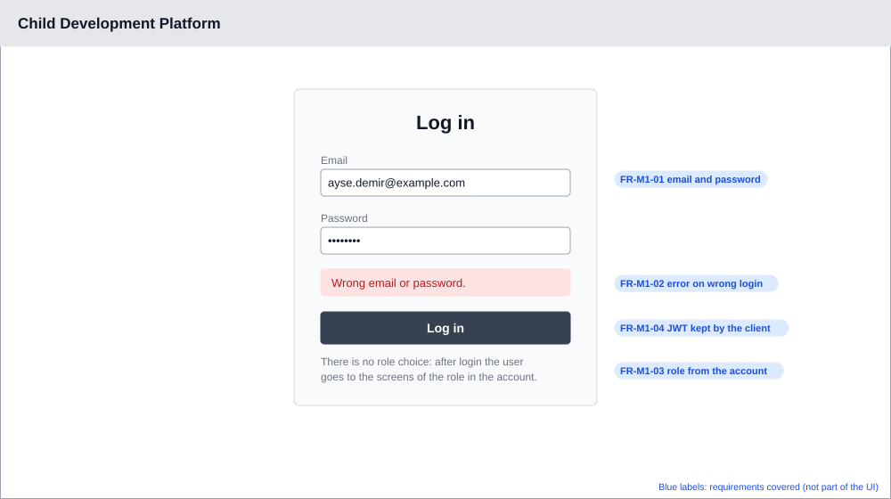

### Parent – weekly dashboard

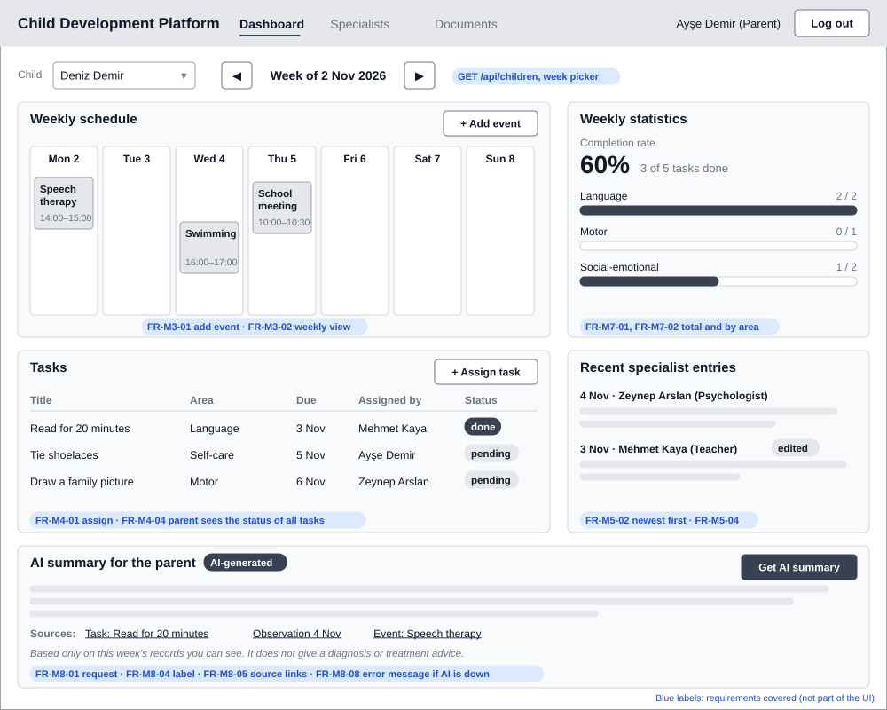

### Child – my week

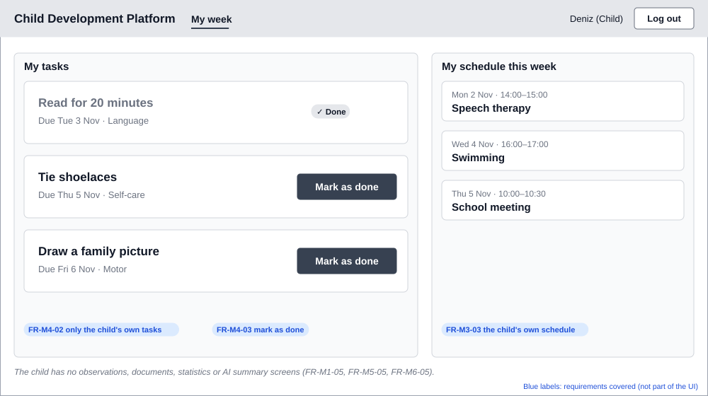

### Specialist – child page

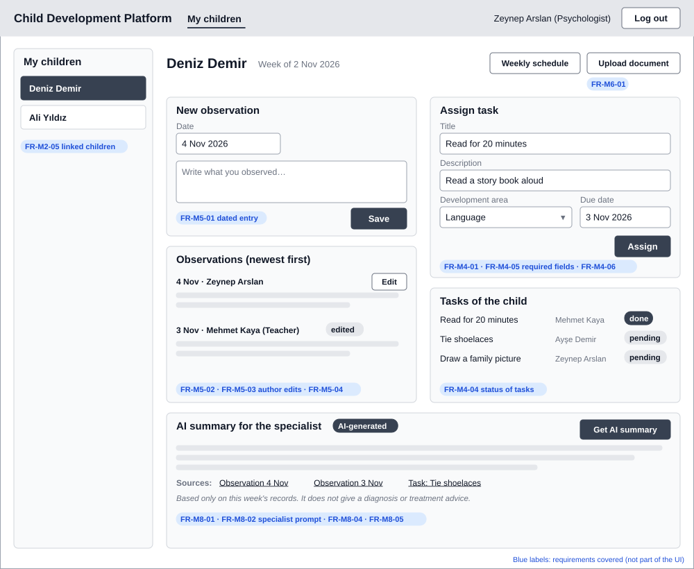

### Parent – linked specialists

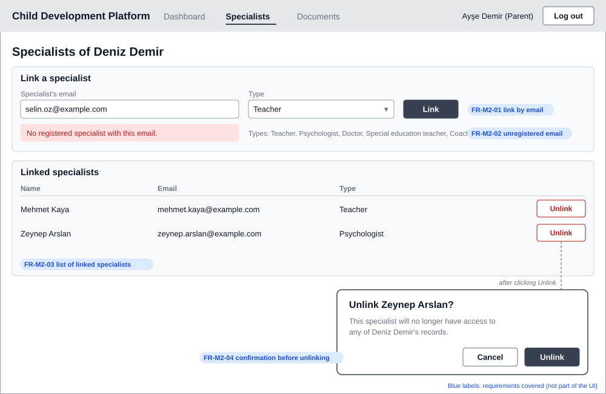

### Documents

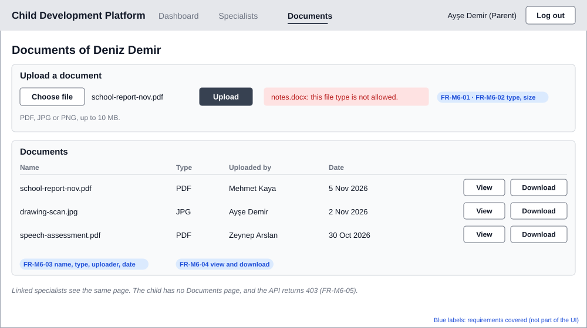

---

## 7. Change Log

| Date | Change | By |
|---|---|---|
| 2026-10-30 | SDD template added (WEB-17) | İrem Ozan |
| 2026-10-30 | AI provider decided: Gemini API (WEB-24) | Sude Naz Metli |
| 2026-11-03 | Architecture overview, data model and API list (Stage A, WEB-28) | Sude Naz Metli |
| 2026-11-04 | `GET /api/tasks` access rule updated to match the revised FR-M4-04 (parent sees all of the child's tasks) | Sude Naz Metli |
| 2026-11-07 | Review fixes (PR #11): `CHILD.child_account_id` and its login relation, event times as datetimes, stored AI summaries (`AI_SUMMARY`), `GET /api/children`, `GET /api/auth/me`, tasks moved under `/api/children/:childId`, AI summary week sent in the request body; linked specialists see all of a child's tasks, as in the assignment's required scope (WEB-28) | Sude Naz Metli |
| 2026-11-07 | Stage B: backend layers, module design, access rules, sequence diagrams for the 3 critical flows, screen wireframes; template notes removed (WEB-28) | Sude Naz Metli |
| 2026-11-07 | Temporary walking-skeleton endpoint `GET /api/tasks` (WEB-30, WEB-31) described separately from the final task endpoint | Sude Naz Metli |
| 2026-11-12 | Sample `tasks` table replaced by the `TASK` entity and the temporary `GET /api/tasks` removed (WEB-47); notes on existing endpoints and files updated | Sude Naz Metli |
| 2026-11-14 | Login also returns the child profile id for a child account; specialist page name corrected to `SpecialistChildrenPage.jsx` (WEB-48) | Sude Naz Metli |
