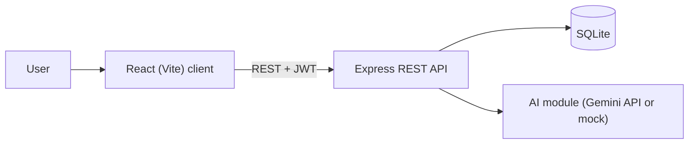
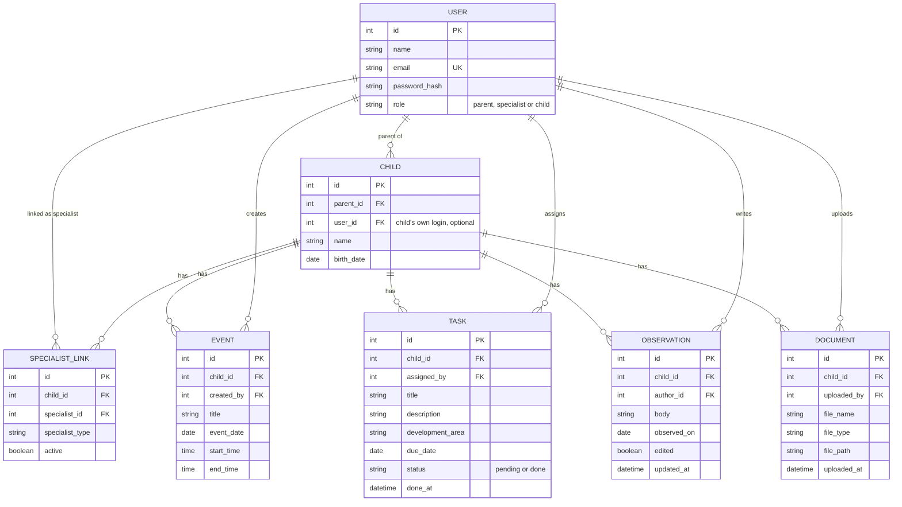
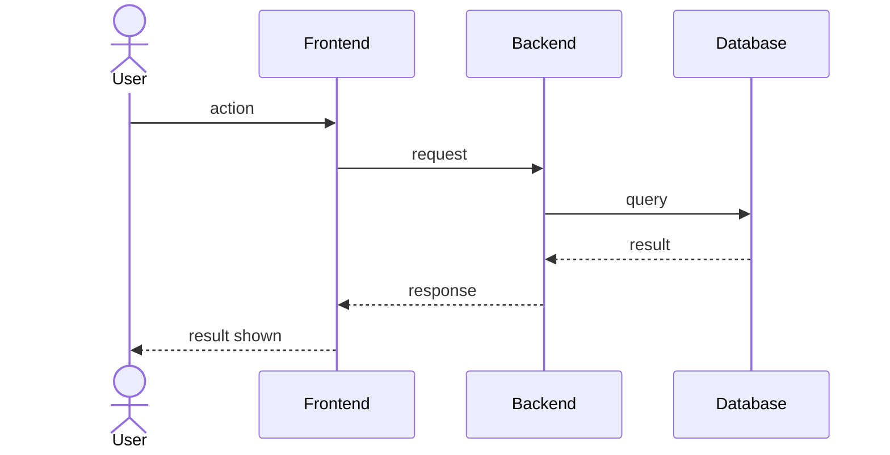

# Software Design Document (SDD)

**Team name:** Web2Dev  
**Version:** ☐ First version (Week 6) ☐ Final (Week 10)  
**Last updated:** 2026-11-03

> Keep this file at `docs/SDD.md`. Describe how the system is built; the SRS describes what it does.
> Diagrams can be written in Mermaid (renders directly on GitHub) or added as images from `docs/img/`.
> Delete the guidance notes (lines starting with `>`) when you fill in a section.

---

## 1. Architecture Overview

The system is a client–server web application. A React (Vite) single-page client calls a REST API built with Express; the API checks each request's JWT and the user's role, and stores data in SQLite. AI summaries are produced by one backend module that calls the Gemini API, or returns a fixed summary in mock mode.

### Technology Stack

| Layer | Technology |
|---|---|
| Frontend | React (Vite) |
| Backend | Node.js, Express, JWT authentication |
| Database | SQLite |
| Testing | Vitest, Jest + Supertest, Playwright |
| CI | GitHub Actions |
| AI | Gemini API, accessed through a single backend module; mock mode for tests and CI |

---

## 2. Module Design

> One row per module (M1–M8, same as your SRS and Jira epics). Name the main components (classes, services, pages) that implement each module.

| Module | Main components | Implements requirements |
|---|---|---|
| M1 | | FR-M1-01, … |
| M2 | | |
| M3 | | |
| M4 | | |
| M5 | | |
| M6 | | |
| M7 | | |
| M8 | | |

---

## 3. Data Model

The entities below come from the roles and modules in the SRS. Each child's records (events, tasks, observations, documents) belong to one child, and access is decided by the user's role and by an active specialist link.

> Note: The `tasks` table created in WEB-23 is a sample table to test the database setup. It will be replaced by the `TASK` entity above.

---

## 4. API / Interfaces

All endpoints except login require a valid JWT (FR-M1-04). Access checks run in the backend for every request (NFR-02). Endpoints marked "planned" are not implemented yet; only `GET /api/health` exists today (WEB-20).

| Method | Endpoint | Description | Module |
|---|---|---|---|
| POST | `/api/auth/login` | Log in with email and password; returns a JWT (FR-M1-01, FR-M1-04) | M1 |
| POST | `/api/auth/logout` | Log out (FR-M1-06, Should) | M1 |
| GET | `/api/health` | Health check; implemented in WEB-20 | — |
| POST | `/api/children/:childId/specialists` | Link a registered specialist by email and type (FR-M2-01, FR-M2-02) | M2 |
| GET | `/api/children/:childId/specialists` | List the specialists linked to a child (FR-M2-03) | M2 |
| DELETE | `/api/children/:childId/specialists/:specialistId` | Unlink a specialist (FR-M2-04) | M2 |
| GET | `/api/specialist/children` | List the children linked to the logged-in specialist (FR-M2-05) | M2 |
| GET | `/api/children/:childId/events?week=YYYY-MM-DD` | Events of a child for one week (FR-M3-02, FR-M3-03) | M3 |
| POST | `/api/children/:childId/events` | Add an event (FR-M3-01) | M3 |
| PUT | `/api/events/:id` | Edit an event by its creator (FR-M3-05, Should) | M3 |
| DELETE | `/api/events/:id` | Delete an event by its creator (FR-M3-05, Should) | M3 |
| GET | `/api/tasks` | Tasks visible to the logged-in user; the child sees own tasks, others see tasks they assigned (FR-M4-02, FR-M4-04). Planned, WEB-30 | M4 |
| POST | `/api/children/:childId/tasks` | Assign a task to a child (FR-M4-01) | M4 |
| PATCH | `/api/tasks/:id/done` | Child marks a task as done (FR-M4-03) | M4 |
| GET | `/api/children/:childId/observations` | List observations, newest first; not available to the child (FR-M5-02, FR-M5-05) | M5 |
| POST | `/api/children/:childId/observations` | Add an observation (FR-M5-01) | M5 |
| PUT | `/api/observations/:id` | Edit an observation; only its author, marked as edited (FR-M5-03, FR-M5-04) | M5 |
| POST | `/api/children/:childId/documents` | Upload a PDF or JPG/PNG file (FR-M6-01, FR-M6-02) | M6 |
| GET | `/api/children/:childId/documents` | List documents; not available to the child (FR-M6-03, FR-M6-05) | M6 |
| GET | `/api/documents/:id` | View or download a document (FR-M6-04) | M6 |
| GET | `/api/children/:childId/stats?week=YYYY-MM-DD` | Task completion rate for a week, total and by development area (FR-M7-01, FR-M7-02) | M7 |
| POST | `/api/children/:childId/ai-summary?week=YYYY-MM-DD` | Request an AI-generated, role-based summary of a week (FR-M8-01 to FR-M8-05) | M8 |

---

## 5. Critical Flows

> Use the same 3 critical flows as SRS Section 4. Add one sequence diagram for each.

### Flow 1:

### Flow 2:

### Flow 3:

---

## 6. User Interface

> Add sketches or screenshots of the main screens (hand-drawn wireframes are fine).

| Screen | Image | Module |
|---|---|---|
| | `docs/img/…` | |

---

## 7. Change Log

| Date | Change | By |
|---|---|---|
| 2026-10-30 | First version | |
| 2026-10-30 | AI provider decided: Gemini API (WEB-24) | Sude Naz Metli |
| 2026-11-03 | Architecture overview, data model and API list (Stage A, WEB-28) | Sude Naz Metli |
