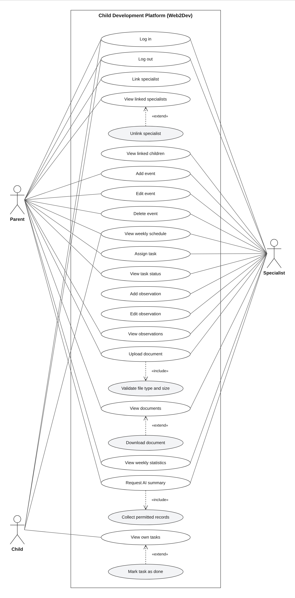

# Software Requirements Specification (SRS)

**Team name:** Web2Dev  
**Version:** ☒ First version (Week 6) ☐ Final (Week 10)  
**Last updated:** 2026-11-03

---

## 1. Introduction

**Purpose of the system**

A web-based decision support platform that brings the parent, the specialists and the child together around one shared weekly schedule, task list and record of observations. An AI component summarizes the week's records for each reader according to their role. The AI only supports decisions: every summary is labelled as AI-generated, is linked to its source records, and never makes a diagnosis or suggests a treatment.

**Users of the system:**

| User type | Description |
|---|---|
| Parent | Owns the child's data, sees all records of the child, links and unlinks specialists, adds events and assigns tasks. |
| Specialist | Teacher, psychologist, doctor, special education teacher or coach. Works only with the children they are linked to: adds events, assigns tasks, writes observations, uploads documents. |
| Child | Sees only their own tasks and weekly schedule, and marks tasks as done. |

---

## 2. Functional Requirements

Priority: **Must** (required for v1.0) / **Should** (planned) / **Could** (if time allows).

### M1 – Login and roles

| ID | Requirement | Priority |
|---|---|---|
| FR-M1-01 | The system shall allow a registered user to log in with email and password. | Must |
| FR-M1-02 | The system shall reject a login with a wrong email or password and show an error message. | Must |
| FR-M1-03 | The system shall take the user's role (parent, specialist or child) from the account; the user shall not choose a role at login. | Must |
| FR-M1-04 | The system shall issue a JWT after a successful login and require a valid token for every API request except login. | Must |
| FR-M1-05 | The system shall show each role only its own screens, and the API shall reject requests to endpoints that the user's role is not allowed to use. | Must |
| FR-M1-06 | The system shall allow the user to log out. | Should |

### M2 – Linking specialists

| ID | Requirement | Priority |
|---|---|---|
| FR-M2-01 | The system shall allow the parent to link a registered specialist to the child by entering the specialist's email and specialist type. | Must |
| FR-M2-02 | The system shall show an error when the entered email does not belong to a registered specialist. | Must |
| FR-M2-03 | The system shall show the parent the list of specialists linked to the child. | Must |
| FR-M2-04 | The system shall allow the parent to unlink a specialist after a confirmation step. | Must |
| FR-M2-05 | The system shall show the specialist the list of children they are linked to. | Must |
| FR-M2-06 | The API shall reject every request about a child from a specialist who is not currently linked to that child, even if the specialist's token is still valid. | Must |

### M3 – Weekly schedule

| ID | Requirement | Priority |
|---|---|---|
| FR-M3-01 | The system shall allow the parent and linked specialists to add an event to the child's schedule with a title, date, start time and end time. | Must |
| FR-M3-02 | The system shall list the child's events for a selected week in a weekly view. | Must |
| FR-M3-03 | The system shall show the child their own weekly schedule. | Must |
| FR-M3-04 | The system shall reject an event whose end time is not after its start time. | Should |
| FR-M3-05 | The system shall allow the creator of an event to edit or delete it. | Should |

### M4 – Tasks

| ID | Requirement | Priority |
|---|---|---|
| FR-M4-01 | The system shall allow the parent and linked specialists to assign a task to the child with a title, description, development area and due date. | Must |
| FR-M4-02 | The system shall show the child only their own tasks. | Must |
| FR-M4-03 | The system shall allow the child to mark a task as done. | Must |
| FR-M4-04 | The system shall show the assigner the status (pending or done) of each task they assigned. | Must |
| FR-M4-05 | The system shall reject a task without a title or due date. | Should |
| FR-M4-06 | The system shall offer the development area as a choice from a fixed list (for example: Language, Motor, Social-emotional, Cognitive, Self-care). | Should |

### M5 – Specialist entries

| ID | Requirement | Priority |
|---|---|---|
| FR-M5-01 | The system shall allow a linked specialist to add a dated observation about the child. | Must |
| FR-M5-02 | The system shall show the parent and linked specialists the child's observations, newest first. | Must |
| FR-M5-03 | The system shall allow only the author of an observation to edit it. | Must |
| FR-M5-04 | The system shall mark an edited observation as "edited". | Must |
| FR-M5-05 | The API shall not return observations to the child. | Must |

### M6 – Documents

| ID | Requirement | Priority |
|---|---|---|
| FR-M6-01 | The system shall allow the parent and linked specialists to upload a PDF or image (JPG, PNG) file for the child. | Must |
| FR-M6-02 | The system shall reject files of other types and files larger than 10 MB. | Should |
| FR-M6-03 | The system shall list the child's documents with name, type, uploader and upload date. | Must |
| FR-M6-04 | The system shall allow the parent and linked specialists to view and download a document. | Must |
| FR-M6-05 | The API shall not allow the child to list or download documents. | Must |

### M7 – Weekly statistics

| ID | Requirement | Priority |
|---|---|---|
| FR-M7-01 | The system shall calculate the task completion rate for a selected week as the number of done tasks divided by the number of tasks due that week. | Must |
| FR-M7-02 | The system shall show the completion rate for the selected week both in total and by development area. | Must |
| FR-M7-03 | The system shall show the weekly statistics to the parent and linked specialists. | Must |
| FR-M7-04 | The system shall show "No tasks this week" instead of a rate when no tasks are due in the selected week. | Should |

### M8 – Role-based AI summary

| ID | Requirement | Priority |
|---|---|---|
| FR-M8-01 | The system shall allow the parent and linked specialists to request an AI summary of a selected week's records. | Must |
| FR-M8-02 | The system shall use separate prompts for the parent and for the specialist. | Must |
| FR-M8-03 | The system shall send the AI service only the records that the requesting user is allowed to see. | Must |
| FR-M8-04 | The system shall label every summary as "AI-generated". | Must |
| FR-M8-05 | The system shall show links to the source records that the summary is based on. | Must |
| FR-M8-06 | The prompt shall instruct the AI to use only the given records and not to make a diagnosis or suggest a treatment. | Must |
| FR-M8-07 | The system shall provide a mock mode that returns a fixed summary without calling the AI service, used in tests and CI. | Must |
| FR-M8-08 | The system shall show an error message when the AI service is unavailable, while the rest of the application keeps working. | Should |

---

## 3. Non-Functional Requirements

| ID | Category | Requirement |
|---|---|---|
| NFR-01 | Security | Passwords are stored only as hashes (bcrypt), never in plain text. |
| NFR-02 | Security | Access rules are checked in the backend for every request; requests without a valid token return 401 and requests to data the user may not access return 403. |
| NFR-03 | Privacy | Only synthetic data created by the seed script is used; the AI API key is kept in a server-side environment variable and never appears in frontend code or in the repository. |
| NFR-04 | Performance | With the seed data on a local machine, each page loads in under 2 seconds. |
| NFR-05 | Maintainability | All tests run in CI on every pull request; branch coverage is at least 40% at v0.2 and at least 60% at v1.0. |

---

## 4. Critical Flows and Acceptance Criteria

| Flow | Related requirements | Acceptance criteria |
|---|---|---|
| Flow 1: A specialist assigns a task and the child completes it | FR-M1-01, FR-M4-01, FR-M4-02, FR-M4-03, FR-M4-04 | **Given** a specialist who is linked to a child is logged in **When** the specialist assigns the task "Read for 20 minutes" to the child **Then** the task appears in the child's task list; **and when** the child marks it as done **Then** the specialist sees its status as "done". |
| Flow 2: The parent links and unlinks a specialist | FR-M2-01, FR-M2-04, FR-M2-05, FR-M2-06 | **Given** the parent is logged in and a specialist is registered **When** the parent links the specialist by email **Then** the child appears in the specialist's list of children; **and when** the parent unlinks the specialist **Then** every API request from that specialist about the child is rejected with 403. |
| Flow 3: The parent gets the AI summary of the week | FR-M8-01, FR-M8-03, FR-M8-04, FR-M8-05, FR-M8-07 | **Given** the child has tasks and observations in the selected week and the AI runs in mock mode **When** the parent requests the weekly summary **Then** a summary labelled "AI-generated" is shown with links to its source records, and it is based only on records the parent is allowed to see. |

---

## 5. Use Case Diagram

The editable source of the diagram is `docs/img/use-case-diagram.drawio` (open it with draw.io / diagrams.net).

---

## 6. Change Log

| Date | Change | By |
|---|---|---|
| 2026-11-03 | First version | İrem Ozan |
